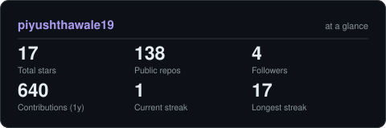
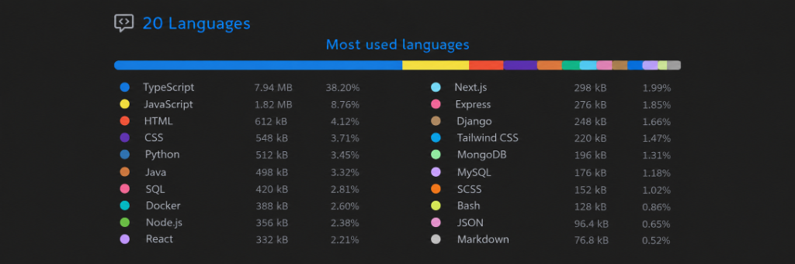

<!-- BANNER - terminal profile.sh --live (additive). Generated by scripts/banner/generate.py. -->
<picture>
  <source media="(prefers-color-scheme: dark)"  srcset="assets/banner-dark.v9.svg">
  <source media="(prefers-color-scheme: light)" srcset="assets/banner-light.v9.svg">
  
</picture>

 

<!-- NAME / TAGLINE - animated typing -->

 

  
  &nbsp;
  

<!-- SOCIALS -->

  &nbsp;&nbsp;
  &nbsp;&nbsp;
  &nbsp;&nbsp;
  &nbsp;&nbsp;
  

---

## 🚀 About Me

Hi, I'm **Piyush Thawale**, a Full-Stack Developer and AI/LLM Application Developer from India 🇮🇳, passionate about building scalable web applications, intelligent AI-powered products, and modern digital experiences.

- 💻 **Full-Stack Development:** Building end-to-end applications using React, Next.js, Node.js, Express, and MongoDB.
- 🤖 **AI & Agentic AI:** Exploring Generative AI, LLM integrations, RAG pipelines, AI agents, and intelligent automation.
- ⚡ **Product Development:** Turning innovative ideas into practical, user-focused digital products.
- 💼 **Experience:** Worked with **Unified Mentor Pvt. Ltd.**, **NullClass Edtech Pvt. Ltd.**, and **InternPe**, along with freelance development.
- 🎓 **Education:** Pursuing **B.Tech in Computer Science & Engineering** — Class of 2026.
- 🌱 **Currently Exploring:** Agentic AI, advanced LLM workflows, AI application architecture, and developer tools.
- 💬 **Ask Me About:** React.js, Next.js, Node.js, TypeScript, MongoDB, REST APIs, and AI Integration.

---

## 🛠️ Tech Stack & Tools

### Programming Languages

  

### Frontend Development

  

### Backend Development & Databases

  

### AI & Developer Tools

  

---

## 📡 Signals 

<table>
<tr>
<td width="50%" align="center" valign="middle">

<!-- Self-rated radar - edit assets/skills.json -->
<picture>
  <source media="(prefers-color-scheme: dark)"  srcset="assets/radar-dark.svg">
  <source media="(prefers-color-scheme: light)" srcset="assets/radar-light.svg">
  
</picture>

</td>
<td width="50%" align="center" valign="middle">

<!-- Hand-authored contract & language stack radar - edit assets/langmix.json -->
<picture>
  <source media="(prefers-color-scheme: dark)"  srcset="assets/radar-langs-dark.svg">
  <source media="(prefers-color-scheme: light)" srcset="assets/radar-langs-light.svg">
  
</picture>

</td>
</tr>
</table>

---

## 💡 Featured Projects

| Project | Description | Technologies |
|---|---|---|
| [**Agentic Studio**](https://agenticstudio-psi.vercel.app/) | AI-powered platform for intelligent content creation and automation workflows. | Next.js, TypeScript, Convex, Clerk, Gemini API, DALL·E |
| **Smart Developer Assistant** | AI-powered developer assistant for project-level debugging, code execution, and API workflows. | React.js, Node.js, Express.js, MongoDB, LLM APIs |
| **Synapse AI** | AI-powered application exploring intelligent workflows and developer productivity. | AI, Full-Stack, Python, FastAPI |
| **Woodcraft Furnishings** | Full-stack furniture e-commerce platform with product catalogs, auth, and admin management. | Django, DRF, React.js, TypeScript, MySQL |
| **Yummy-Fi** | Food delivery and tiffin service platform with customer and administrative features. | Next.js, Tailwind CSS, MongoDB, Firebase, Socket.io |

---

## 📊 Numbers matter? ohhh yes.

<picture>
  <source media="(prefers-color-scheme: dark)"  srcset="assets/card-stats-dark.svg">
  <source media="(prefers-color-scheme: light)" srcset="assets/card-stats-light.svg">
  
</picture>

  

  

 

---
 

### 💭 Developer's Quote
*"Great things are built one line of code at a time."*

**⭐ Thanks for visiting my profile! Let's build something amazing together.**

 

` Built with ❤️ by @piyushthawale19 `

